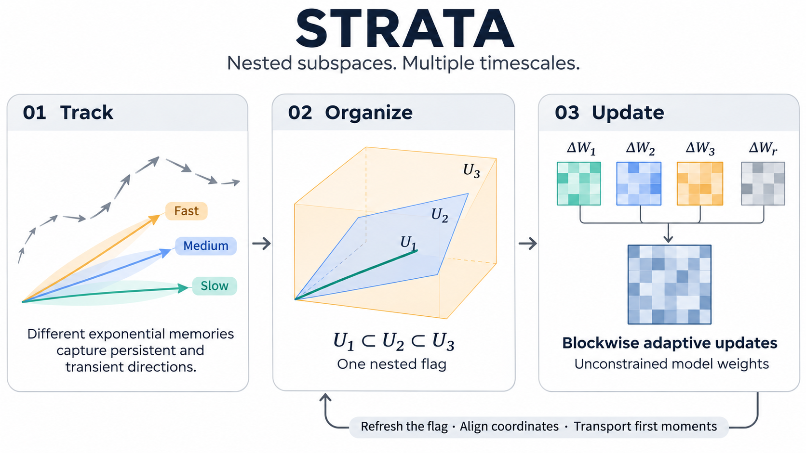

<div align="center">

# STRATA
### Flag-manifold optimizer state for multi-timescale gradients

**Learn nested gradient subspaces. Keep model weights unconstrained.**

[](docs/manuscript.pdf)
[](#quickstart)
[](docs/EXPERIMENTS.md)
[](https://github.com/Hik289/manifold-strata-optimization/archive/refs/heads/main.zip)

[](https://github.com/Hik289/manifold-strata-optimization/actions/workflows/tests.yml)
[](pyproject.toml)
[](https://pytorch.org/)
[](LICENSE)

[Method](#the-idea) · [Installation](#quickstart) · [Benchmarks](#experiments) · [Evidence](#reported-evidence) · [Citation](#citation) · [中文使用说明](docs/README.zh-CN.md)



</div>

## The idea

A single gradient subspace mixes directions that persist throughout training with
directions that change quickly. **STRATA-AdamW** represents optimizer state on a
nested flag, $\mathcal U_1\subset\mathcal U_2\subset\mathcal U_3$, and uses
multi-timescale covariance sketches to track this structure online.

| Track | Organize | Update |
| :--- | :--- | :--- |
| Exponential covariance sketches capture different memory horizons. | Nested cumulative subspaces define orthogonal incremental blocks. | Blockwise Adam directions and a normalized residual combine in the original weight space. |

At a flag refresh, the optimizer aligns coordinates using blockwise Procrustes
rotations, transports first moments, and restarts second-moment statistics with
separate bias-correction counters. This changes **optimizer state**, not the
model architecture or the feasible set of weights.

**Included:** the optimizer and geometric primitives; four baseline optimizers;
all experiment trainers, data preparation, ablations, queue recipes, verification
and plotting code; the working manuscript and a frozen results snapshot.

[Algorithm specification](docs/algorithm.md) · [Optimizer API](docs/API.md) · [Reproducibility](docs/REPRODUCIBILITY.md)

## Quickstart

The optimizer and numerical checks run on CPU. The image, stream, graph and
language benchmark trainers generally require CUDA; see the experiment guide
for per-trainer requirements. Linux is recommended for the queue workers.

```bash
git clone https://github.com/Hik289/manifold-strata-optimization.git
cd manifold-strata-optimization
python -m venv .venv
source .venv/bin/activate
python -m pip install --upgrade pip

# Install a PyTorch wheel appropriate for your CPU/CUDA platform first if needed.
python -m pip install -e .
python examples/quickstart.py --steps 40
python experiments/test_numerical.py
```

The quickstart is a small, data-free regression problem. The numerical suite
checks orthogonality, nesting, gradient decomposition, energy conservation,
gauge identities, retraction, transport and the one-level reduction to
Single-Grassmann. Neither command launches a benchmark grid.

### Use it in PyTorch

```python
from strata_pkg import STRATAAdamW

optimizer = STRATAAdamW(
    model.parameters(),
    lr=3e-4,
    ranks=[16, 32, 64],       # cumulative dimensions, not three separate ranks
    rhos=[0.999, 0.98, 0.9],
    a_ks=[1.0, 0.7, 0.4],
    a_perp=0.2,
    tau=50,
    xi=1e-3,
    eps=1e-6,
    seed=42,
)

optimizer.zero_grad(set_to_none=True)
loss = criterion(model(inputs), targets)
loss.backward()
optimizer.step()
```

Eligible matrix parameters use the flag branch; convolutional kernels are
flattened internally. Biases, normalization parameters and matrices too small
for the requested maximum rank use a dense AdamW branch. The ranks and memory
settings above are an example, not a universal best configuration.

## Experiments

Install the optional benchmark dependencies:

```bash
python -m pip install -e ".[experiments]"
```

| Task family | Included settings | Entry point |
| :--- | :--- | :--- |
| Image classification | MNIST, Fashion-MNIST, CIFAR-10/100, Tiny-ImageNet, ImageNet-100 | [`train_vision.py`](experiments/train_vision.py), [`train_image_benchmarks.py`](experiments/revision/train_image_benchmarks.py) |
| Continual learning & shifts | Rotated-MNIST, Split-CIFAR-100, CIFAR shifts, DomainNet, CORe50 | [`train_stream.py`](experiments/revision/train_stream.py), [`train_image_benchmarks.py`](experiments/revision/train_image_benchmarks.py) |
| Graph learning | Cora, CiteSeer, PubMed; GCN, GAT, GraphSAGE, GCNII | [`train_graph_extra.py`](experiments/revision/train_graph_extra.py) |
| Tabular classification | Adult, Covertype, red/white Wine Quality | [`train_tabular.py`](experiments/revision/train_tabular.py) |
| Language & sequences | GPT-2 Small/Medium, decoder baseline; WikiText-2 LSTM/GRU/Transformer | [`train_lm.py`](experiments/revision/train_lm.py), [`train_sequence.py`](experiments/revision/train_sequence.py) |
| Forecasting | ETTh1 / ETTh2, L96 / H24 | [`train_new_families.py`](experiments/revision/train_new_families.py) |
| Recommendation | MovieLens 100K / 1M explicit ratings | [`train_new_families.py`](experiments/revision/train_new_families.py) |
| Sensor drift | UCI gas-sensor drift, fine-tuning and replay | [`train_new_families.py`](experiments/revision/train_new_families.py) |
| Scientific ML | Burgers, Poisson, generated Darcy / FNO | [`train_pinn.py`](experiments/train_pinn.py), [`train_poisson.py`](experiments/train_poisson.py), [`train_darcy.py`](experiments/revision/train_darcy.py) |

### Run one configuration

```bash
cd experiments
python revision/prepare_tabular.py --root ../data
python revision/train_tabular.py \
  --dataset wine_red --width 512 --method strata \
  --lr 0.0003 --epochs 1000 --data ../data \
  --out runs_revision/wine_red_example
```

Data preparation downloads the tabular suite and freezes its splits. This is
one full-budget run. A comparison requires every declared method and candidate
configuration; do not select a rate from test outcomes. For a short execution
check, use the trainer's `--smoke --epochs 2` with a **different output folder**.

[Full commands and data setup →](docs/EXPERIMENTS.md)
[All 856 configuration recipes →](configs/experiments.json)
[Choose a queue subset →](configs/README.md)

## Reported evidence

The accompanying manuscript reports **seed-42 case studies**, not multi-seed
statistical significance or universal optimizer superiority. A few completed
comparisons illustrate the scope of the evidence:

| Setting | Metric | STRATA | Single-G | AdamW | GaLore | Independent |
| :--- | :--- | ---: | ---: | ---: | ---: | ---: |
| ETTh2 / H24 | MSE ↓ | **1.74404** | 2.37970 | 2.16884 | 1.79170 | 2.18874 |
| Rotated-MNIST / fine-tuning | Accuracy ↑ | 57.655% | 57.109% | **62.193%** | 59.691% | 57.278% |
| Rotated-MNIST / replay | Accuracy ↑ | 88.582% | 87.170% | **90.720%** | 88.880% | 87.140% |

Rates/configurations are selected using validation within each method after the
full stated search finishes. The ETT setting uses six candidates per method;
the Rotated-MNIST settings use two rates per method. These selected examples
are descriptive; stronger baselines and adverse outcomes are retained in the
[manuscript](docs/manuscript.pdf) and [complete evidence records](results/README.md).
Optimizer tensor storage and peak allocated memory are reported separately.

**Release snapshot:** 556 completed configurations, 278 deferred configurations
and one failed candidate, with other long runs unfinished at the manuscript's
2026-11-05 04:08 UTC snapshot. The 856 recipes describe the expanded design;
they are not 856 completed experiments. No credentials, raw datasets or trained
checkpoints are included.

## Repository map

```text
experiments/strata_pkg/    Optimizer, geometry, baselines and diagnostics
experiments/revision/     Expanded trainers, preprocessing, ablations and audits
experiments/train_*.py    Original vision, graph and scientific-ML trainers
configs/                  Portable experiment recipes and queue instructions
examples/                 Data-free optimizer quickstart
analysis/                 Independent verification scripts
figures/                  Original figure-generation code
data/scripts/             Data-pipeline and gradient-structure checks
tools/                    Queue initialization and release checks
results/                  Frozen, configuration-level evidence tables
paper/                    Manuscript LaTeX source and figures
docs/                     Guides, manuscript PDF and intuition PNG
```

The historical launchers and archived variants are retained for completeness.
Use the documented direct trainer commands for a first run. Queue activation
and service scripts can start long jobs and are intended for deliberate use
after inspecting their configuration.

## Citation

Use GitHub's **Cite this repository** button, or:

```bibtex
@software{strata2026,
  author = {STRATA Contributors},
  title = {STRATA: Flag-Manifold Optimizer State},
  year = {2026},
  url = {https://github.com/Hik289/manifold-strata-optimization}
}
```

## License & acknowledgments

Code is released under the [MIT License](LICENSE). The vendored Muon baseline
retains its original license and author credits; see
[third-party notices](THIRD_PARTY_NOTICES.md). Dataset licenses remain with
their respective providers. The manuscript is a working research document;
conference-style presentation does not imply conference acceptance.
