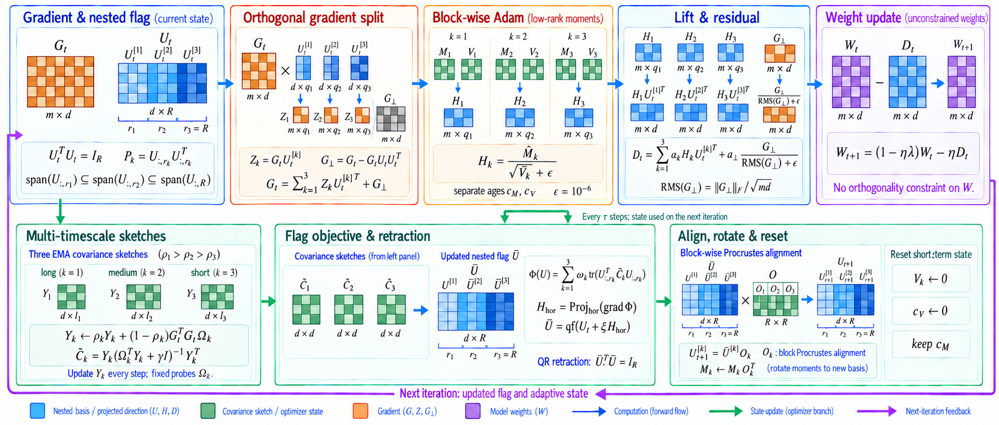

<div align="center">
  <h1>STRATA: Optimization with Nested Gradient Subspaces</h1>
  <p align="center">
    <a href="LICENSE"></a>
    <a href="pyproject.toml"></a>
  </p>
</div>

> Gradient directions can change at different speeds during training. STRATA
> tracks their history over several time scales and uses nested subspaces to
> organize the optimizer's updates. Model weights remain unconstrained.

<p align="center">
  <a href="fig_method_update_detailed.png">
    
  </a>
</p>

## How it works

**STRATA-AdamW** is a PyTorch optimizer. It stores adaptive gradient averages
in several nested subspaces: each smaller subspace lies inside the next one.
In mathematics, this structure is called a **flag**.

| Step | What STRATA does |
| :--- | :--- |
| Track gradient history | Update compact estimates of gradient correlations, with different decay rates for long and short memory. |
| Update the subspaces | Adjust a shared orthonormal basis. Its first columns define the smallest subspace; additional columns extend it. |
| Update the weights | Apply Adam within each separate block, map the updates back to the weight matrix, and add the remaining gradient component. |

When the basis changes, STRATA aligns the new coordinates with the old ones
and rotates the stored gradient averages. It resets the squared-gradient
averages and tracks their step counts separately. The
[algorithm guide](docs/algorithm.md) explains these steps and their formulas.

This repository contains the optimizer, baselines, training scripts, data
preparation, experiment configurations, checks, plotting tools, paper source,
and saved result tables.

[Optimizer API](docs/API.md) · [Reproduction guide](docs/REPRODUCIBILITY.md)

## Quickstart

The example and numerical checks below run on CPU and need no dataset.
Most image, graph, tabular and language training scripts require a CUDA GPU.
See the [experiment guide](docs/EXPERIMENTS.md) for each task's requirements.

```bash
git clone https://github.com/Hik289/manifold-strata-optimization.git
cd manifold-strata-optimization
python -m venv .venv
source .venv/bin/activate
python -m pip install --upgrade pip

# If needed, first install a PyTorch build for your CPU or CUDA version.
python -m pip install -e .
python examples/quickstart.py --steps 40
python experiments/test_numerical.py
```

The example trains a small regression model. The 13 numerical checks verify
properties such as orthogonal basis columns, nested subspaces, correct gradient
splitting and agreement with Single-Grassmann when only one level is used.

## Experiments

Install the extra training dependencies from the repository root:

```bash
python -m pip install -e ".[experiments]"
```

| Task | Datasets and models | Training script |
| :--- | :--- | :--- |
| Image classification | MNIST, Fashion-MNIST, CIFAR-10/100, Tiny-ImageNet, ImageNet-100 | [`train_vision.py`](experiments/train_vision.py), [`train_image_benchmarks.py`](experiments/revision/train_image_benchmarks.py) |
| Continual learning and data shifts | Rotated-MNIST, Split-CIFAR-100, CIFAR shifts, DomainNet, CORe50 | [`train_stream.py`](experiments/revision/train_stream.py), [`train_image_benchmarks.py`](experiments/revision/train_image_benchmarks.py) |
| Graph learning | Cora, CiteSeer, PubMed; GCN, GAT, GraphSAGE, GCNII | [`train_graph_extra.py`](experiments/revision/train_graph_extra.py) |
| Tabular classification | Adult, Covertype, red/white Wine Quality | [`train_tabular.py`](experiments/revision/train_tabular.py) |
| Language modeling | GPT-2 Small/Medium and a decoder baseline; WikiText-2 LSTM/GRU/Transformer | [`train_lm.py`](experiments/revision/train_lm.py), [`train_sequence.py`](experiments/revision/train_sequence.py) |
| Time-series forecasting | ETTh1 / ETTh2; 96 input steps, 24 prediction steps | [`train_new_families.py`](experiments/revision/train_new_families.py) |
| Rating prediction | MovieLens 100K / 1M | [`train_new_families.py`](experiments/revision/train_new_families.py) |
| Sensor drift | UCI gas-sensor drift; fine-tuning and replay | [`train_new_families.py`](experiments/revision/train_new_families.py) |
| Scientific machine learning | Burgers, Poisson, generated Darcy data / FNO | [`train_pinn.py`](experiments/train_pinn.py), [`train_poisson.py`](experiments/train_poisson.py), [`train_darcy.py`](experiments/revision/train_darcy.py) |

### Run one experiment

The following commands prepare the tabular datasets and train one Wine Quality
model for 1000 epochs. The training command requires CUDA.

```bash
cd experiments
python revision/prepare_tabular.py --root ../data
python revision/train_tabular.py \
  --dataset wine_red --width 512 --method strata \
  --lr 0.0003 --epochs 1000 --data ../data \
  --out runs_revision/wine_red_example
```

For a short setup check, add `--smoke --epochs 2` and use a different output
folder. To compare methods, run all configurations specified for that
comparison, then select each method's learning rate using validation scores.

[Data preparation and training commands](docs/EXPERIMENTS.md) ·
[856 saved experiment configurations](configs/experiments.json) ·
[Run a selected group of experiments](configs/README.md)

## Repository structure

```text
experiments/strata_pkg/        Optimizer, geometry and baseline implementations
experiments/revision/         Additional training, data preparation and analysis
experiments/train_*.py         Original image, graph and scientific-ML training
configs/                      Experiment configurations and queue instructions
examples/                     Small optimizer example with no dataset download
analysis/                     Independent checks of results and theory
figures/                      Figure-generation scripts
data/scripts/                 Data checks and gradient measurements
tools/                        Queue setup and repository checks
results/                      Saved results for completed experiments
paper/                        LaTeX source and PNG figures
docs/                         Usage guides and algorithm explanation
fig_method_update_detailed.png  Detailed method diagram
```

For a first experiment, use a command from the experiment guide. Older launch
scripts and archived training versions are also included. Check their GPU
assignments and selected experiments before using them to start a batch.

## Citation

Use GitHub's **Cite this repository** button, or:

```bibtex
@software{strata2026,
  author = {STRATA Contributors},
  title = {STRATA: Flag-Manifold Optimizer State},
  year = {2026},
  url = {https://github.com/Hik289/manifold-strata-optimization}
}
```
